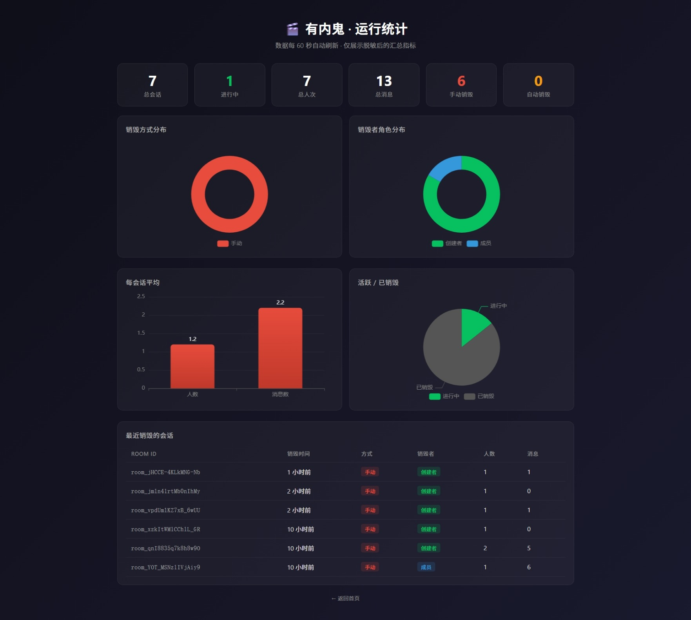

# 有内鬼 🎬

> [English](./README.en.md) · 中文

> **「有内鬼，终止交易。」** ——《无间道》2002

---

## 这是什么？

「有内鬼」是一个**双向平等、聊完即焚、零社交沉淀**的临时沟通协商窗口。

### 解决什么问题？

```
电话销售想加你微信介绍产品，你不想加但又不好意思拒绝
       ↓
你被困在一个「临时沟通」里，进退两难
       ↓
「有内鬼」提供一个协商窗口：
  ✅ 聊成了 → 自愿留联系方式（产品不干预）
  ✅ 聊崩了 → 任一方一键「结束会话」，数据立即清空
```

### 核心设计

- **双向平等终止权**：创建者和参与者任何一方都可以主动结束会话，对方无需确认
- **双层销毁**：手动终止（优先，立即可控）+ 到期自动销毁（兜底，防止遗忘）
- **零社交沉淀**：不做好友系统、不做历史消息、不存储联系人
- **真人验证**：OAuth 登录确保是真人，但不存储社交关系数据
- **Markdown 导出**：销毁前可导出会话留档，销毁后永久删除
- **公开可验证**：任何人都能访问 `/stats.html` 查看实时运行统计，亲眼确认数据真的在被清理

---

## 快速开始（本地开发）

```bash
# 1. 安装依赖
npm install

# 2. 配置环境变量（复制 .env.example）
cp .env.example .env
# 编辑 .env，填入 OAuth AppID/Secret

# 3. 启动 Redis（需要 Docker）
docker run -d --name youneigui-redis -p 6379:6379 redis:alpine

# 4. 启动开发服务器
npm run dev
# 访问 http://localhost:3000
```

## Docker Compose 部署

```bash
# 配置 .env 后一键启动
docker-compose up -d

# 访问 http://your-server:3000
```

## OAuth 配置说明

当前版本仅支持 **GitHub OAuth**，申请地址：

👉 [github.com/settings/developers → New OAuth App](https://github.com/settings/developers)

| 字段 | 填什么 |
|------|--------|
| Application name | 有内鬼 Dev（或自定义） |
| Homepage URL | `http://localhost:3000`（或你的部署域名） |
| Authorization callback URL | `http://localhost:3000/auth/github/callback`（必须精确匹配） |

创建后拿到 Client ID + Client Secret，填入 `.env`：

```bash
GITHUB_CLIENT_ID=xxx
GITHUB_CLIENT_SECRET=xxx
```

### 接入更多 OAuth 渠道（微信 / 微博 / Google / ...）

当前代码按 **单 provider 可扩展架构** 设计。**推荐流程：先 fork，再让 AI 干活。**

1. **Fork 本仓库** → clone 到本地
2. **让 AI 帮你写**：打开 Trae / Cursor，把仓库导进去，给它这个 prompt：
   ```
   请帮我接入 <目标渠道名> OAuth。
   参考文档：https://www.passportjs.org/packages/passport-<channel>/
   我的 Client ID / Secret：<你的值>
   
   现有架构：
   - src/config.js 存放各渠道 clientId/clientSecret
   - src/oauth/index.js 注册 passport Strategy + 两条路由 /auth/<channel> 和 /auth/<channel>/callback
   - 登录页 HTML 在同文件的 router.get('/login') 内联模板里
   ```
   它会一次完成：安装 passport-<channel>、config 加字段、Strategy 注册、两条路由、登录页按钮。
3. 手动验证 callbackURL 和申请时填的一致 → 提交 PR 回原仓库（如果想贡献回去）或继续自己用。

> 为什么 MVP 只留 GitHub？OAuth 渠道越多，测试矩阵越大（每个渠道的 callbackURL、scope、用户 profile 字段名都不同）。留一个跑通的，扩展交给社区和 AI。

---

## 多语言支持（i18n）

当前内置 **中文（默认）+ 英文**，顶部导航栏有 `EN / 中` 切换按钮，选择后存 `localStorage`，刷新即生效。

### 架构

- **前端**：`public/js/i18n.js` — 中文原文作为 key，运行时遍历 `<body>` 下所有文本节点匹配替换。现有 HTML **零改动**。
- **后端 Markdown 导出**：`src/export/routes.js` 接收 `?lang=en` 参数，两套模板（zh / en），`Date.toLocaleString` 也会切换 locale。

### 添加新语言（日语 / 韩语 / 法语 / ...）

**推荐流程：先 fork，再让 AI 翻译。**

1. **Fork 本仓库** → clone 到本地
2. **让 AI 帮你翻译**：打开 Trae / Cursor，给它这个 prompt：
   ```
   请帮我添加 <目标语言名> 支持。
   
   需要改两个文件：
   1. public/js/i18n.js — 复制现有 LANGS.en 改成 LANGS.<lang>，把所有英文翻译成 <目标语言>
   2. src/export/routes.js — 复制现有 I18N.en 改成 I18N.<lang>，把所有英文翻译成 <目标语言>
   
   注意：
   - zh → en 的词典里，中文原文是 key，英文是 value
   - 确保每条 zh 词条都有对应的 <目标语言> value
   - export/routes.js 里还要在 switch 里加一条 case '<lang>': dateLocale = '<lang>-<REGION>'
   ```
3. 手动刷新页面，点顶栏 `EN / 中` 按钮验证切换正常 → 提交 PR 回原仓库或继续自己用。

---

## 项目结构

```
youneigui/
├── docs/
│   └── 产品需求说明书.md
├── src/
│   ├── oauth/        # OAuth 登录模块
│   ├── room/         # 房间（会话）管理模块
│   ├── ws/           # WebSocket 实时通信模块
│   └── export/       # Markdown 导出模块
├── public/           # 前端静态资源（单页 HTML + 原生 JS）
├── redis/            # Redis 数据模型和脚本
├── docker-compose.yml
├── .env.example
└── LICENSE
```

## 🔍 数据可验证

"聊完即焚"不只是说说——我们提供公开的**运行统计**页面，任何人都能亲眼看到数据真的在被清理：

- 当前活跃房间数 / 已销毁房间数
- 总会话数、总消息数、总人次
- 手动销毁 vs 自动销毁比例
- 最近销毁会话的脱敏明细

👉 部署后访问 `/stats.html`



## 安全边界

- ✅ 全站 HTTPS
- ✅ 聊天内容只存 Redis 并设 TTL，不落持久库
- ✅ 导出文件即时生成返回，不留存
- ✅ 销毁后仅保留脱敏审计日志（房间ID、时间、人数），不含聊天内容

> 本产品用于隐私友好的临时沟通，不构成合规涉密通信方案，不替代 NDA 或正式合同。

## 明确不做

- ❌ 不加好友、不建群、不提供对方资料页
- ❌ 不做历史会话列表
- ❌ 不做已读回执、在线状态
- ❌ 不获取微信/微博昵称头像
- ❌ 不提供一键跳转微信或复制微信号
- ❌ 不阻止截图（截图无法技术阻止）

## 许可证

AGPL-3.0 © 有内鬼开发者

## 贡献

欢迎提交 Issue 和 PR。开源验证项目，大家一起来完善。

---

### 已知风险

- 微信内置浏览器对第三方 OAuth 回调可能有拦截，需实测
- 微信 snsapi_base 网页授权需已认证服务号
- 截图无法技术阻止，产品只降低「对话长期残留」风险
