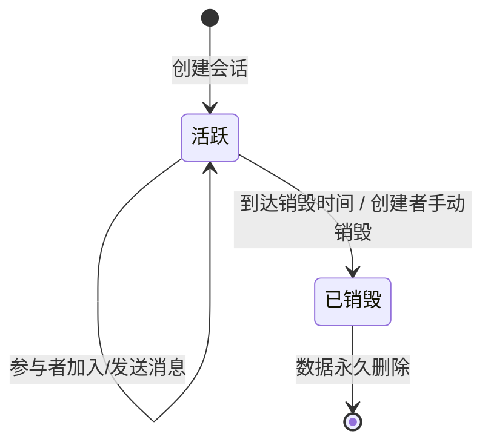

# 有内鬼 · 产品需求说明书（v0.2 MVP）

> 版本：0.2（MVP 范围）
> 日期：2026-11-03
> 产品定位：**双向平等、无沉淀的临时沟通协商窗口**
> 开源地址：[github.com/有内鬼/有内鬼](https://github.com/youneigui/youneigui)

---

## 1. 背景与目标

### 1.1 观察到的问题
中文互联网的沟通工具（微信、QQ、Slack）默认**永久沉淀会话和社交关系**，但存在两类明确的临时沟通场景，传统 IM 完全不适配：

**场景 A：内容触发咨询**
- 发布项目说明书/招聘JD/技术分享后，陌生人来咨询细节
- 线下活动结束后，临时讨论组需要解散
- 买卖双方交易完成后，沟通内容无保留必要

**场景 B：销售/营销协商（更普遍）**
- 电话销售人员希望用微信介绍产品，但客户**不想加好友**（怕被后续骚扰）
- 客户觉得不想合作时，没有「体面退出并切断所有连接」的选项——拉黑对方已经产生了社交关系沉淀，单纯不回消息又有「不礼貌」的心理负担
- 销售和客户双方都需要一个「协商窗口」：聊好了可以自愿留联系方式继续，聊崩了任何一方都可以一键结束，结束即销毁，互不打扰

两类场景的共同痛点：用户**不想加好友**（避免社交沉淀负担）、**不想永久存档**（避免历史包袱）、**不想被强制留在对话中**（需要平等的退出权）。传统 IM 没有提供「用完即弃、平等退出」的合法选项——要么被迫加好友，要么用一次性邮箱/飞书文档评论区这类非专用工具。

### 1.2 产品决策
提供一个**双向平等、无需社交关系绑定、可随时终止的临时沟通协商窗口**，核心设计：
- 用 OAuth 验证真人（防骚扰），但**默认不产生任何社交关系**
- **双方平等的终止权**：创建者和参与者**任何一方**都可以主动「结束会话」，点击后立即销毁所有数据，对方无法继续发送消息
- **双层销毁机制**：手动终止（优先）+ 创建者预设的到期自动销毁（兜底，防止一方结束不了）
- 提供 Markdown 导出作为「有用内容留存」的兜底方案，销毁后无法再导出
- 自愿留联系方式的行为由用户自主完成（产品不拦截、不引导）

### 1.3 可观测的预期结果
- 发布内容的人（如项目说明书作者、销售人员）能附临时沟通入口，无需加微信即可接收咨询/介绍产品
- 咨询方/客户在不想合作时，能一键结束会话，所有数据立即清除，不会被后续骚扰
- 双方中任何一方想留联系方式（如销售和客户达成合作意向），由用户在聊天中自主完成，产品不干预
- 会话销毁后，不产生任何历史沉淀，不占用用户任何社交资源
- 如果沟通中有有用信息，用户能提前导出 Markdown 留档

---

## 2. 范围

### 2.1 P0 最小完整旅程（MVP 必做）
| 环节 | 具体内容 |
|------|----------|
| 入口条件 | 所有用户完成 OAuth 登录（验证真人） |
| P0 动作 | 1. 创建临时会话（设置销毁时间、主题，生成房间码/短链接）<br>2. 加入会话（输入房间码或点击短链接）<br>3. 实时文字聊天<br>4. 导出会话为 Markdown<br>5. 双方平等结束会话（任一方点击立即销毁，或到达销毁时间自动销毁） |
| 完成证据 | - 创建者可见会话剩余存活时间，双方可见「结束会话」按钮<br>- 销毁后，房间码/短链接完全失效<br>- 被结束方收到系统通知，无法继续发送消息<br>- 导出的 Markdown 可在本地查看完整会话 |
| 恢复路径 | - OAuth 登录失败：支持重试或切换渠道<br>- 房间码失效：提示「会话已销毁」<br>- 网络断开：自动重连，显示状态<br>- 导出失败：提示重试 |

### 2.2 P1 支持功能（MVP 后迭代）
- 浏览器扩展：注入 Notion/语雀等内容发布页面，一键生成临时会话入口
- 更多 OAuth 渠道（支付宝、钉钉）
- 图片发送（仅限单张小图，避免存储压力）
- 创建者成员管理（踢人、静音）[Assumption, TBD：临时沟通可能不需要]
- 浏览器通知 API 集成（新消息提醒）

### 2.3 明确排除的功能（避免误解）
❌ 好友系统/通讯录：默认不支持加好友，自愿留联系方式由用户在聊天中自主完成，产品不提供入口
❌ 历史消息搜索：会话销毁前通过 Markdown 导出实现留存，销毁后无数据可搜
❌ 多端同步：会话数据仅在销毁前存在，无需跨端同步
❌ 富媒体（视频/语音/文件）：MVP 仅支持纯文字
❌ 批量通知（邮件/短信）：依赖浏览器通知 API（可选）

---

## 3. 产品模型

### 3.1 角色
| 角色 | 定义 | 权限范围 |
|------|------|----------|
| 创建者 | 发起临时会话的用户（通常是发布内容的人） | 销毁时间设置、会话主题编辑、提前销毁、成员邀请、导出 Markdown |
| 参与者 | 通过房间码/短链接加入的用户（通常是来咨询的人） | 发送消息、导出 Markdown、自愿留联系方式、退出会话 |

### 3.2 核心对象：临时会话（Room）
| 字段 | 类型 | 必填 | 规则 |
|------|------|------|------|
| room_id | 字符串 | 系统生成 | 唯一标识，用于后端存储 |
| 房间码 | 6-8 位字母数字 | 系统生成 | 方便手动输入，如 `ABX3K9` |
| 短链接 | 字符串 | 系统生成 | 如 `tool.temp/ABX3K9` |
| 主题 | 字符串 | 创建者必填 | 最多 50 字，如「XX项目说明书咨询」 |
| 创建者 | 用户 ID | 系统绑定 | 唯一 |
| 销毁时间 | 时间戳 | 创建者设置 | 预设选项：1小时/6小时/24小时/3天/7天；支持自定义（范围 [TBD：10分钟, 30天]） |
| 销毁触发方式 | 枚举 | 系统记录 | 手动终止/到期自动销毁（销毁后才记录，用于系统通知来源） |
| 手动终止发起者 | 用户 ID | 系统记录 | 谁点击了结束会话（销毁后记录为元数据，用于销毁通知中的「[昵称] 已结束会话」） |
| 创建时间 | 时间戳 | 系统生成 | 用于计算剩余时间 |
| 消息列表 | 数组 | 系统维护 | 仅存储未销毁的会话消息 |
| 成员列表 | 数组 | 系统维护 | 记录加入的用户 ID、加入时间 |
| 状态 | 枚举 | 系统维护 | 活跃/已销毁 |

### 3.3 会话生命周期状态


| 状态 | 可见性 | 可执行操作 |
|------|--------|------------|
| 活跃 | 所有已登录的创建者/参与者可访问 | 创建者：编辑主题、手动销毁、导出 Markdown<br>参与者：发送消息、导出 Markdown |
| 已销毁 | 任何人通过房间码/短链接访问时，提示「会话已销毁」 | 无可用操作，所有数据已永久删除 |

---

## 4. 功能需求

### 4.1 OAuth 登录
#### 4.1.1 目标
验证用户是真人（防机器人骚扰），同时**不存储用户的社交关系数据**（如好友列表、联系人）。

#### 4.1.2 触发
用户打开产品首页时，自动进入登录流程（无需手动点击登录按钮）。

#### 4.1.3 处理规则
- 支持 [TBD：2个国内可用的 OAuth 渠道，如微信扫码、GitHub（面向技术用户）]
- 登录成功后，仅存储：用户 ID、OAuth 提供的昵称、头像（可选）
- 不存储：用户的社交关系、邮箱、手机号（除非 OAuth 渠道强制返回，且用户同意）
- 会话销毁后，所有与该会话绑定的用户临时数据（如成员列表、消息记录）永久删除

#### 4.1.4 例外情况
| 场景 | 产品行为 |
|------|----------|
| OAuth 登录失败（如用户取消授权） | 显示「登录失败」，提供「重试」和「切换登录方式」按钮 |
| 第三方 OAuth 服务不可用 | 显示「登录服务暂时不可用，请稍后再试」，并提供切换登录方式的入口 |
| 用户登录后关闭浏览器，下次访问 | 自动保持登录状态（默认登录有效期 [TBD：7天]） |

---

### 4.2 会话创建
#### 4.2.1 目标
创建者快速生成一个临时沟通入口，自定义销毁时间和主题。

#### 4.2.2 触发
创建者登录后，点击「创建临时会话」按钮。

#### 4.2.3 字段与校验
| 字段 | 类型 | 必填 | 校验规则 | 错误提示 |
|------|------|------|----------|----------|
| 会话主题 | 文本 | 是 | 1-50 字，支持中英文/数字 | 「主题最多 50 字」 |
| 销毁时间 | 选项/自定义 | 是 | 预设选项：1小时/6小时/24小时/3天/7天；自定义范围 [TBD：10分钟, 30天] | 「销毁时间需在 10 分钟至 30 天之间」 |

#### 4.2.4 处理规则
- 点击「创建」后，系统自动生成：
  1. 6-8 位随机房间码（大写字母+数字，无易混淆字符如 0/O、1/I）
  2. 短链接（格式：`[产品域名]/[房间码]`）
- 创建成功后，直接进入会话页面，顶部显示「剩余存活时间：XX 小时 XX 分」

#### 4.2.5 创建者可用的辅助操作
- 「复制房间码」：一键复制到剪贴板
- 「复制短链接」：一键复制到剪贴板
- 「生成二维码」：生成房间码对应的二维码，可嵌入内容页面（如项目说明书）

---

### 4.3 会话加入
#### 4.3.1 目标
参与者通过简单方式加入临时会话，无需复杂操作。

#### 4.3.2 触发
参与者通过以下任一方式进入：
1. 手动输入房间码（在产品首页或会话入口页面）
2. 点击短链接（直接进入）
3. 扫描房间码对应的二维码（直接进入）

#### 4.3.3 处理规则
- 参与者必须先完成 OAuth 登录（若未登录，会跳转登录流程，登录后自动回到加入流程）
- 房间码/短链接/二维码仅在会话**活跃**状态下有效
- 加入成功后，自动进入会话页面，系统在聊天区发送一条系统消息：「XXX 加入了会话」（XXX 为 OAuth 昵称）

#### 4.3.4 例外情况
| 场景 | 产品行为 |
|------|----------|
| 房间码/短链接/二维码对应的会话已销毁 | 显示「该会话已销毁」，提供「创建自己的会话」按钮 |
| 参与者重复加入同一会话 | 不重复计入成员列表，直接进入已加入的会话页面 |
| 房间码格式错误 | 提示「房间码格式错误，请检查」 |

---

### 4.4 实时文字聊天
#### 4.4.1 目标
创建者和参与者能实时收发文字消息，无延迟。

#### 4.4.2 触发
参与者或创建者在会话页面输入文字并点击发送（或按 Enter 键）。

#### 4.4.3 处理规则
- 仅支持**纯文字**（MVP 不支持图片/表情/文件）
- 单条消息最多 [TBD：2000 字]
- 消息实时推送给会话内所有在线成员
- 聊天区显示：发送者昵称（OAuth 昵称）、发送时间（精确到分钟）、消息内容
- 发送者自己的消息显示在右侧，他人的消息显示在左侧（类似微信布局）
- 系统消息（如「XXX 加入会话」「会话将在 XX 分钟后销毁」）显示在聊天区中间，灰色字体

#### 4.4.4 例外情况
| 场景 | 产品行为 |
|------|----------|
| 网络断开（WebSocket 连接中断） | 聊天区顶部显示「网络断开，正在重连...」，自动重试（重试间隔 1s → 2s → 5s，超过 [TBD：30s] 仍失败则提示「重连失败，请检查网络」） |
| 单条消息超出字数限制 | 发送按钮置灰，提示「消息最多 2000 字」 |
| 会话已销毁时仍尝试发送 | 提示「会话已销毁，无法发送消息」，并引导退出 |

---

### 4.5 Markdown 导出
#### 4.5.1 目标
在会话销毁前，允许创建者和参与者导出完整会话内容为本地 Markdown 文件，解决「有用信息随会话销毁消失」的痛点。

#### 4.5.2 触发
点击会话页面右上角「导出 Markdown」按钮（创建者和参与者均可见）。

#### 4.5.3 导出内容格式
```markdown
# 临时会话：[会话主题]
- 创建者：[OAuth 昵称]
- 创建时间：[YYYY-MM-DD HH:MM]
- 销毁时间：[YYYY-MM-DD HH:MM]
- 成员：[成员昵称1]、[成员昵称2]...

---

## 会话记录
### 2026-11-03 14:35
**张三**：你好，我想了解一下项目说明书里提到的合作模式...

### 2026-11-03 14:37
**李四（创建者）**：合作模式有两种：1. 纯咨询 2. 联合开发...

---

> 本会话由「有内鬼」生成，已导出后内容与线上会话无关
```

#### 4.5.4 处理规则
- 导出文件名为：`[会话主题]_[导出时间].md`（自动过滤文件系统不支持的字符）
- 导出内容包含：会话元信息（主题、创建者、时间）、成员列表、完整消息记录（按时间排序）
- 会话销毁后，导出按钮置灰，提示「会话已销毁，无法导出」

#### 4.5.5 例外情况
| 场景 | 产品行为 |
|------|----------|
| 导出失败（如浏览器下载被拦截） | 提示「导出失败，请检查浏览器下载权限」，提供重试按钮 |
| 会话销毁前导出成功 | 浏览器自动下载 .md 文件到本地，线上会话继续运行直到销毁时间 |

---

### 4.6 会话销毁（双层机制）
#### 4.6.1 目标
确保会话数据在**不再需要时立即清除**，实现「用完即弃、无沉淀」的核心承诺。采用**双层销毁机制**：手动终止（优先，双方平等）+ 到期自动销毁（兜底）。

#### 4.6.2 触发条件（两种路径均生效，先到先执行）
| 路径 | 触发方式 | 谁可以触发 | 优先级 |
|------|----------|-----------|--------|
| 手动终止 | 会话页面的「结束会话」按钮 | **创建者和参与者，任何一方** | 高（立即执行，无需等待） |
| 到期自动销毁 | 到达创建者预设的销毁时间 | 系统自动触发 | 低（兜底，防止一方结束不了） |

#### 4.6.3 处理规则

##### 自动销毁倒计时
会话页面顶部始终显示「剩余存活时间：XX 天 XX 小时 XX 分」，剩余 10 分钟时显示**红色高亮**，剩余 1 分钟时系统发送消息：「会话将在 1 分钟后自动销毁，请尽快导出有用内容或主动结束」。

##### 手动终止（双方平等）
- 创建者和参与者**都可见**「结束会话」按钮，点击后弹出二次确认
- **任何一方**点击「确定」后，会话**立即进入销毁流程**，双方页面同时收到系统消息：「[操作方昵称] 已结束会话」
- 操作方和被终止方的**页面同时切换到「会话已销毁」状态**，无法继续发送消息
- 对方无需任何确认——这是「平等终止权」的核心，避免陷入一方想结束但对方不同意的僵局

##### 销毁后行为（手动和自动相同）
1. 所有成员的会话页面显示「该会话已销毁」，无法再发送/导出
2. 房间码/短链接/二维码完全失效，访问时显示「会话已销毁」
3. 后端永久删除所有数据：消息、成员列表、会话元数据（**无备份，无恢复可能**）
4. 销毁操作**不可撤销**——无论手动还是自动，一旦执行立即生效

#### 4.6.4 手动终止的二次确认弹窗（创建者和参与者通用）
点击「结束会话」后，弹出二次确认弹窗：
```text
⚠️ 确定要结束该会话吗？
结束后将立即删除所有消息数据，双方都无法再发送或导出内容。
你已经做好的 Markdown 导出文件仍然保存在本地。

[取消] [确定结束]
```

#### 4.6.5 手动终止 vs 自动销毁的边界
| 场景 | 产品行为 |
|------|----------|
| 一方手动终止，另一方正在发送消息 | 销毁流程优先执行，发送中的消息直接丢弃 |
| 双方几乎同时点击「结束会话」 | 第一个到达服务器的触发生效，第二个触发直接忽略（幂等处理） |
| 手动终止后，原自动销毁时间未到期 | 不再执行自动销毁（会话已销毁，自动定时器直接清除） |
| 手动终止发起方是否可以撤回 | **不可以**，点击「确定结束」后立即生效，无撤回窗口 |

---

## 5. 共享规则与例外

### 5.1 跨模块权限矩阵
| 操作 | 创建者 | 参与者 | 未登录用户 |
|------|--------|--------|------------|
| 创建会话 | ✅ | ❌ | ❌ |
| 加入会话 | ✅（自动） | ✅ | ❌（需登录） |
| 发送消息 | ✅ | ✅ | ❌ |
| 导出 Markdown | ✅ | ✅ | ❌ |
| 编辑会话主题 | ✅ | ❌ | ❌ |
| 查看剩余存活时间 | ✅ | ✅ | ❌ |
| **结束会话（手动销毁）** | ✅ | ✅ | ❌ |
| 邀请成员（生成房间码/链接） | ✅ | ❌ | ❌ |

### 5.2 跨模块校验规则
1. 所有操作（除 OAuth 登录）均需在「已登录 + 会话活跃」状态下执行
2. 会话销毁时间一旦设置，**创建者可编辑剩余时间（延长或缩短），但不能取消销毁**（确保产品的「无沉淀」承诺）
3. **手动结束会话不可撤销**：创建者和参与者任何一方点击「确定结束」后立即生效，无撤回窗口
4. 成员列表仅记录加入的用户 ID 和加入时间，不存储任何社交关系数据
5. 会话销毁后，所有与该会话绑定的临时数据（消息、成员）**永不恢复**
6. 会话销毁的双层机制中，手动终止优先，手动终止后自动销毁定时器立即清除

### 5.3 例外兜底规则
| 极端场景 | 产品行为 |
|----------|----------|
| 服务器故障导致销毁延迟 | 恢复后立即执行销毁，销毁时间最多延迟 [TBD：1小时] |
| 创建者账号被封禁 | 其创建的所有活跃会话立即进入倒计时（默认 1 小时后销毁），并通知所有成员 |
| 有人恶意刷屏 | MVP 暂不做反骚扰功能，依赖 OAuth 真人验证 + 会话自动销毁兜底；P1 考虑增加「消息频率限制」（如 10 秒内最多发送 5 条） |

---

## 6. 开放问题（暂不阻塞 MVP，需后续确认）

| 编号 | 问题 | 影响范围 | 建议决策时间 |
|------|------|----------|--------------|
| Q1 | OAuth 登录具体选哪些渠道？（微信扫码需要企业资质，GitHub 适合技术用户） | 登录流程 | 开发前 |
| Q2 | 销毁时间的可选范围？（下限 10 分钟？上限 30 天？） | 会话创建 | 开发前 |
| Q3 | 单条消息字数上限？ | 文字聊天 | 开发前 |
| Q4 | 是否支持匿名 OAuth（如 GitHub 不需要实名认证，微信需要）？ | 防骚扰策略 | 上线前 |
| Q5 | 会话销毁的服务器故障兜底延迟上限？ | 销毁可靠性 | 开发前 |
| Q6 | 创建者账号被封禁后，活跃会话的默认销毁倒计时？ | 异常兜底 | 开发前 |
| Q7 | 是否需要成员数量上限？（如最多 100 人） | 性能与体验 | 开发前 |
